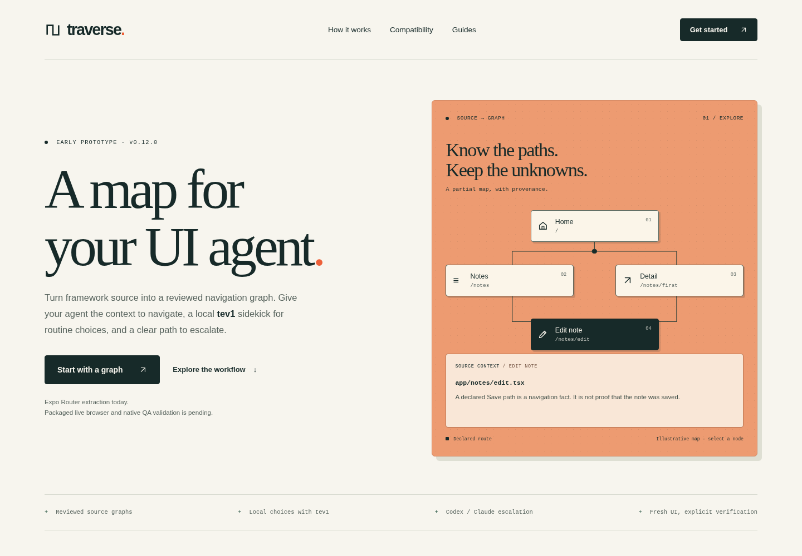

# Website preview evidence

Captured locally in Chromium 154.0.8037.57 on Linux x86_64, Node 24.19.0, from a loopback-only static preview. These are screenshots of the website, not Traverse runner or native-app validation.

- [Desktop, 1440px, full page](desktop.png)
- [Mobile, 390px, full page](mobile.png)
- [Desktop, 1440px, first viewport](desktop-viewport.png)
- [Browser QA receipt](browser.json)
- [Source identities and check summary](verification.json)

## Checks

The dependency-free site check and build passed: four local assets, 30 valid links and 19 unique IDs. Repository guide paths and headings are checked against actual local files, since the GitHub source is private. JavaScript syntax checks passed. The optional Python Playwright script exercised Chromium at widths 320, 390, 768, 1024 and 1440 with no page overflow. Skip navigation, focus indication, Enter/Space graph interactions, native disclosures, model-setup deep links, both clipboard buttons, reduced-motion scrolling and the no-JavaScript reading path passed. No console errors or uncaught exceptions were observed. Visual review led to inline SVG decorative icons so font fallback cannot hide arrows.

Expo example typecheck, lint (with `EXPO_NO_TELEMETRY=1`), all 14 snapshot tests and offline web export passed. The initial lint attempt failed when telemetry tried to write outside the workspace; disabling telemetry, as in the contributor environment, resolved it. CLI `init --project examples/expo --no-interactive --dry-run --json` recognized Router 57.0.28 and exited 0 without writes. `npm pack --dry-run --ignore-scripts` confirmed the documented `mistermunchkin-traverse-0.12.0.tgz` name and excludes the website from the installed runtime. No global CLI installation was changed.

`npm run check` was attempted and refused this Linux environment with “Current contributor checks target macOS arm64; other platforms need separate validation.” A separate serial `npm test` run completed with 234 passed, 20 failed and 3 skipped (257 total). The 20 failures concern managed-model platform assumptions and subprocess reaping assertions. The same 20 failing test names reproduced in a focused run against unchanged main commit `7ae1459e1fb18cd61ed9a4f56b0e6bd6711592fd`, using the same installed dependency trees and Linux/Node environment. This is not a full gate pass. Local raw diagnostics remain ignored under `.checks/website-linux/`.

The repository-required independent review found no blocking issues in content accuracy, accessibility, tooling or scope. Hosted macOS contributor CI is tracked in the draft PR; its actual result must be read there.

## Limits

Headless Chromium viewport emulation does not establish Safari, Firefox, physical mobile device or screen-reader behavior. The macOS installed-package isolation smoke could not run locally. No model weights, real provider inference, app/device driving, release, hosting or deployment was executed. Framework adapters and distribution pipelines are outside this change.
